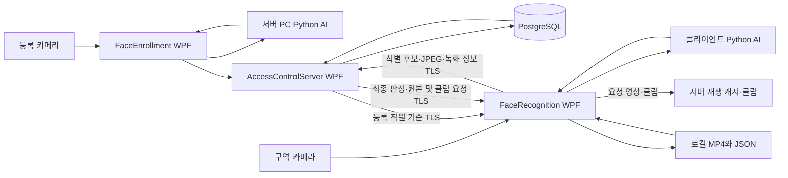

# 얼굴 인식 출입 통제 프로젝트 분석

2026-10-21 후속 리팩토링: [두 프로젝트 개발 과정](development-history.md), [변경·정리·검증 결과](refactor-20261021.md)를 추가했다. 아래 본문은 최초 정적 분석의 범위를 기록한다. 후속 작업에서는 Python 49개·9개와 C# 갤러리 검사·WPF 빌드를 수행했으며 실제 카메라·운영 DB·LAN은 새로 시험하지 않았다.

분석일: 2026-10-21 · 대상: 제공된 AccessControl_UI 소스 및 문서 · 기준: 12.3 코드 정리본

이 문서는 소스 정적 분석과 기존 검증 기록을 통합한 것이다. 이번 분석에서 앱·카메라·모델 추론·DB·LAN을 실행하지 않았다. 기존 문서의 PASS는 과거 기록이며 이번 재검증 결과가 아니다. 개인/팀 여부, 개발 기간, 본인 기여도와 기술 선택의 실제 배경은 미확인이다.

## 1. 프로젝트 개요

사전학습 얼굴 분석 모델과 C# 데스크톱 앱, PostgreSQL, 네트워크 통신, 영상 처리를 연결한 출입 통제 포트폴리오 데모다. 모델 자체의 학습 프로젝트가 아니라 등록·식별·권한 판정·기록·영상 조회를 연결하는 시스템 통합 프로젝트로 설명하는 것이 코드와 일치한다.

서버는 직원과 권한, 얼굴 등록, 최종 판정과 DB 기록, 관제·재생을 맡는다. 카메라 클라이언트는 실시간 얼굴 분석, 전체 직원 자동 식별, 로컬 녹화와 요청 클립 생성을 맡는다. 등록 앱은 서버 관리자가 실행하는 별도 WPF 프로세스다. 동일 PC 실행과 두 PC LAN 배치용 코드가 있지만 실제 두 PC 현장 통합 완료 여부는 제공 기록으로 확정할 수 없다. 실제 문 개폐 장치와 라이브니스는 확인된 구현 범위가 아니다.

### 개발 환경 — 선언과 실제 실행 환경 구분

| 영역 | 소스에 선언된 기술 | 근거 |
|---|---|---|
| UI | C#, .NET 10 Windows, WPF, WPF-UI 4.3.0 | 세 앱 csproj |
| SDK | 10.0.100, latestFeature roll-forward | ../global.json |
| DB | PostgreSQL, Npgsql 8.0.9 | 서버 csproj·DB 코드 |
| AI 실행 대상 | Windows x64, Python 3.11, CPU | ../FaceAI/README.md |
| 모델 연동 | DeepFace 0.0.93, TensorFlow 2.16.2, tf-keras 2.16.0 | ../FaceAI/requirements.txt |
| 검출·정렬 | dlib HOG 및 5점 눈 정렬 | ../FaceAI/dlib_fast.py |
| 자세·특징 | MediaPipe 0.10.21, ArcFace 512차원 | ../FaceAI/face_engine.py |
| 영상 | OpenCV 4.11.0.86, MP4·JPEG | requirements와 영상 코드 |
| 통신·보호 | TCP, SslStream, 인증서 지문·공유 키, Windows DPAPI CurrentUser | Network·Shared/PairingStore.cs |

패키지 선언은 사용자 PC의 설치 상태를 증명하지 않는다. PostgreSQL 서버 버전, dlib의 현재 설치 버전, 실제 하드웨어는 이번 분석에서 확인하지 않았다.

## 2. 전체 시스템 구성

이 그림은 논리적 구성이다. 등록 앱의 서버 API 연동과 C#–Python 명령 경로를 요약했으며 모든 내부 소켓·프로세스를 별도 노드로 그린 배포 실측도가 아니다. 기본 포트는 판정 5050, JPEG 5051, 얼굴·녹화·파일 API 5052다. DB 직접 접근은 서버가 담당한다.

### 폴더별 책임

| 폴더 | 역할과 읽을 파일 |
|---|---|
| AccessControlServer | 직원 관리, 얼굴 저장, 판정, 영상 관제. FaceDatabase.cs, AccessEventDatabase.cs, RecordingDatabase.cs |
| FaceEnrollment | 등록 UI와 등록 진행 제어. MainWindow.xaml.cs |
| FaceRecognition | 식별 UI·동기화·녹화·클립. GallerySynchronizer.cs, ObservationSource.cs, RecordingSync.cs, MediaAgent.cs |
| FaceAI | ai_worker.py, face_engine.py, guided_enrollment.py, face_gallery.py, segment_recorder.py, export_clip.py |
| Shared | AiClient.cs의 Python 연동, PairingStore.cs의 연결 설정 보호, 공통 패널 |
| Network | 판정·관측·영상 TCP 프로토콜, TLS 연결 |
| FaceService | 얼굴·녹화·클립 계약, 원격 전송, 보관 정책 |
| Database | DB 변경 및 확인 SQL. 이 폴더는 08~15 파일을 포함하며 완전한 초기 DB 생성 절차는 이번 자료만으로 확정하지 않음 |
| Checks·FaceChecks·NetworkChecks·RetentionChecks·TwoPcChecks·DbChecks | 계약, 통신, 보관, 동기화·파일 전송과 SQL 검사 소스 |

## 3. 핵심 기능과 구현 근거

### 안내형 얼굴 등록

정면 보정 후 안내된 방향의 후보를 수집하고 선명도와 각도 차이로 대표 특징을 고른다. 현재 안내형 등록은 정면 1개와 좌·우·상·하 각 2개, 총 9개 대표 샘플이다. 과거 9방향 등록과 현재의 9개 대표 샘플을 혼동하지 않는다. 기존 5방향·9방향 기준도 호환 대상으로 유지한다.

`FaceAI/guided_enrollment.py`는 현재 안내 단계만 수집하고 정면 복귀를 요구한다. `AccessControlServer/FaceDatabase.cs`는 선택 직원의 등록을 트랜잭션으로 저장하고 특징을 DPAPI로 보호한다. 기존 정상 기준을 미완료 등록으로 덮어쓰지 않는 것이 중요한 처리 원칙이다.

### 전체 직원 자동 식별(1:N)

`FaceAI/face_engine.py`에서 유효한 단일 얼굴을 확인하고 특징을 추출한다. 얼굴/메시 불일치, 작은 얼굴, 흐림, 다중 얼굴 등은 진행을 차단한다. `face_gallery.py`는 정규화된 특징과 전체 샘플 행렬의 코사인 거리를 계산하고 직원별 최소 거리로 순위를 정한다.

- 기본 후보 기준: 1위 거리 0.45 이하.
- 2위 직원과의 거리 차이가 0.05 미만이면 AMBIGUOUS로 보류.
- 같은 직원의 자세 샘플끼리 모호성을 만들지 않도록 직원 단위로 묶는다.
- 명시적 상한은 1000명이다. 처리 성능을 보장하는 측정 결과가 아니다.

이 값들은 현재 구현 설정이며 인식 정확도나 임계값의 통계적 타당성을 입증하지 않는다. 비활성 직원·출입 권한 없는 직원도 호환되는 활성 얼굴 등록이 있으면 식별 대상이고, 최종 거부는 서버가 수행한다.

### 기준 동기화와 서버 최종 판정

`GallerySynchronizer.cs`는 각 갱신 작업 뒤 약 10초 대기하며 목록을 재조회한다. 변경 없는 특징을 재사용하고, 목록/서버 세션/특징 검증이 끝난 완성본만 공개한다. `face_gallery.py`도 begin/add/commit으로 부분 적용을 막는다. 따라서 ‘정확히 10초 안에 항상 반영’되는 보장은 아니다.

`AccessEventDatabase.cs`는 식별 토큰, 결과 최신성, 모호성, 장치·직원·등록·권한을 확인한다. 최종 이벤트는 DB 트랜잭션으로 기록한다. `Network/AccessDecision.cs`의 안정적인 이벤트 ID와 INSERT 충돌 처리는 재전송 중복을 방지한다. 클라이언트의 일치 후보와 서버의 출입 허가는 다른 단계다.

### 녹화·재생·클립·장애 복구

원본 MP4는 클라이언트에, 구간 정보는 JSON과 서버 DB에 보관한다. 영상 파일을 DB BLOB으로 저장하는 구조가 아니다. 기본 약 60초 단위·10fps 녹화이며 실측 결과가 아니다. 서버는 필요한 원본/클립을 요청하고 크기·SHA-256을 확인한다.

`RecordingSync.cs`는 JSON을 내구성 있는 미전송 목록으로 사용하고 구간별 실패 격리와 시도 순환을 수행한다. `RecordingRetention.cs`의 원본 보관 정책은 완료 후 72시간이며 사용 중인 파일은 정리를 미룬다. 서버 클립과 클라이언트 임시 파일 경로를 분리한다. 서버 장애 중에도 클라이언트·카메라가 실행 중이면 로컬 녹화를 유지하고 복구 후 정보를 재전송하도록 구현되어 있다.

## 4. 데이터 구조와 실행 안내

코드에서 확인한 주요 테이블은 `persons`, `admin_accounts`, `client_instances`, `cameras`, `face_enrollments`, `face_templates`, `access_events`, `recording_segments`, `exported_clips`다. 클립은 ClipDatabase.cs에서 관리한다. 실제 운영 스키마와 행 수는 조회하지 않았다.

1. 기존 DB·AppData·모델 캐시를 보존한다. 초기 SQL을 무작정 재실행하지 않는다.
2. 서버는 Start_Server.cmd, 클라이언트는 Start_Client.cmd를 사용한다. 스크립트는 .NET 빌드 후 EXE를 실행한다.
3. Python 환경 준비는 FaceAI/setup_environment.bat와 check_setup.py --prepare 안내를 참고한다. 이번 분석에서는 실행하거나 패키지를 설치하지 않았다.
4. 서버 DB 연결·관리자 설정·TCP 시작 후 클라이언트 연결 코드를 적용한다. 연결 코드는 비밀정보로 취급한다.
5. AI 경로는 현재 폴더의 FaceAI로 지정하고 카메라를 연결한다. 최신 버전은 직원 선택 없이 자동 기준 동기화·보정·식별로 진행한다.
6. 카메라 한 대는 등록·인증 앱에서 동시에 열지 않는다. 실제 두 PC 배치 시 포트·방화벽·시계·DPAPI 사용자 계정 조건을 확인한다.

세부 절차는 [최신 12.3 안내](guides/AUTO_IDENTIFICATION_12_3_KO.md)와 [기존 두 PC 배치 안내](guides/DEPLOY_TWO_PC.md)를 함께 읽되, 후자의 1:1 직원 선택 절차는 과거 버전으로 취급한다.

## 5. 결과와 검증 수준

| 구분 | 제공 자료의 기록 | 해석 |
|---|---|---|
| 사용자 환경 과거 확인 | 5방향 저장·복원, 허가/거부·기록, 재연결, MP4·클립 재생 | history/VERIFIED_PROGRESS.md의 시점과 조건에 한정 |
| 12.3 정리 전 확인 | 다른 직원 자동 식별, 권한 없는 직원·미등록자 거부, 동기화 대기 0, 과거 클립 3건 FAILED 정리 | history/REFACTOR_12_3_KO.md에 기록됨. 이번 독립 재현 아님 |
| 과거 자동 검사 | WPF 3개 빌드, Python 49개, TLS·전송·동기화·SQL 등 통과 기록 | 일부는 Linux·합성 입력·대역·PGlite 사용 |
| 이번 분석 | 소스·프로젝트 파일·기존 문서 대조, 문서 작성 | 앱·빌드·시험·DB·카메라 실행하지 않음 |

Windows 최신 정리본 UI·카메라·DPAPI·LAN 통합, 조명·각도별 정확도/오인식률, 실제 만료 원본의 DB 삭제 전이, DB 백업 복원 시험은 여전히 확인이 필요하다. 사용자 환경의 부분 확인을 현재 버전 전체 검증으로 확대하지 않는다.

## 6. 문서 간 차이와 우선순위

- README·VERIFIED_PROGRESS 상단과 12.3 안내를 최신 흐름으로 읽는다. DEPLOY_TWO_PC, FaceAI/README, NEXT_DEVELOPMENT에는 과거 1:1 및 미연결 설명이 남아 있다.
- 과거 문서의 ‘1:N 미구현’은 현재 코드와 다르다. 현재는 구현되어 있다.
- FaceAI/README의 fast 검출 ‘확대 없음’ 설명과 달리 현재 dlib_fast.py는 첫 검출이 비면 upsample=1로 한 번 재시도한다. 아래 방향 문제의 완전 해결을 의미하지 않는다.
- 과거 동기화 대기·클립 잔여 확인 과제는 REFACTOR_12_3_KO에 더 늦은 사용자 확인 기록이 있다. 개별 원인까지 모두 밝혀졌다는 뜻은 아니다.
- 원문 이력은 보존했고 이 문서에서 차이를 연결했다. 새 검증이 생기면 해당 항목의 날짜·조건·근거를 갱신한다.

## 7. 포트폴리오 구성과 다음 확인

발표는 개요 → 위 시스템 구성도 → 핵심 2~3페이지(등록·1:N / 서버 판정·동기화 / 녹화·복구) → 문제 해결 경험 순서가 적합하다. 경험 후보는 TLS 개인 키 로딩, 녹화 실패 격리·경로 전환, WPF 부모 중복 연결, 클립 실패 상태와 임시 파일 분리다. 실제로 본인이 수행한 부분을 확인한 뒤 사용한다.

필요한 사용자 정보: 개발 기간, 개인/팀 여부와 담당 범위, 기술을 선택한 실제 이유, 가장 어려웠던 문제와 직접 시도한 해결 과정, 최신 버전의 현장 시연 결과. 저장소 URL과 공개 여부는 미확인이다. 대상 폴더 자체의 .git은 없었으며 Git 명령은 환경 오류로 성공하지 않아 상위 저장소·원격 연결 여부는 확정하지 않았다.

관련 문서: [전체 트러블슈팅](troubleshooting.md), [기존 코드 안내](guides/CODE_GUIDE_KO.md), [12.3 코드 정리·검증](history/REFACTOR_12_3_KO.md), [시점별 사용자 확인](history/VERIFIED_PROGRESS.md).

## 2026-10-22 최신 변경 · 12.4

DB 세션 재사용·선택형 암호화 자동 연결·TCP 자동 시작·저장된 페어링 자동 연결과 UI를 개선했다. [현재 시작 안내](guides/STARTUP_UI_12_4_KO.md)와 [이번 검증 및 현장 확인 항목](validation/VALIDATION_STAGE12_4_WINDOWS.md)을 우선한다. 얼굴 식별은 기존 12.3 흐름을 유지한다.

2026-10-22 추가: 안내형 등록의 아래 방향 수집 시점 누락 경로를 수정하고 부족한 시점을 안내한다. [적용·검증 및 실제 카메라 재시험](fixes/GUIDED_DOWN_20261022_KO.md).
