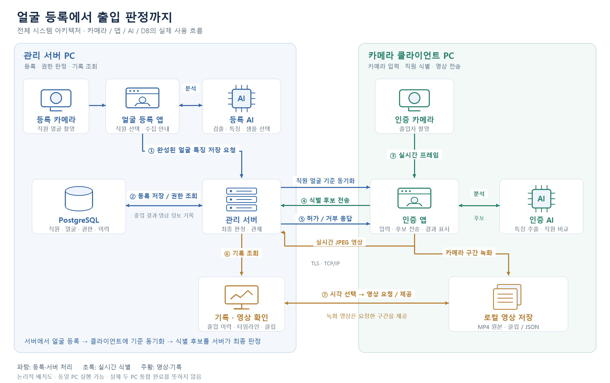

# 얼굴 인식 기반 출입 통제 시스템

**얼굴 등록·직원 식별·출입 권한 판정부터 실시간 영상 관제와 기록 조회까지 연결한 데스크톱 시스템입니다.**

사전학습 얼굴 분석 모델을 Python으로 연동하고, C# WPF 서버·클라이언트와 PostgreSQL을 연결했습니다. 모델 학습 자체보다 **AI 결과를 실제 업무 흐름과 연결하는 시스템 구현**에 초점을 맞췄습니다.

## 대표 화면

실제 실행 화면은 촬영 후 추가할 예정입니다.

| 화면 | 보여줄 내용 |
|---|---|
| 서버 관제 | 클라이언트 영상, 연결 상태, 출입 판정과 최근 기록 |
| 얼굴 등록 | 직원 선택, 방향별 얼굴 수집, DB 저장 |
| 인증 클라이언트 | 식별된 직원과 서버의 최종 허가·거부 결과 |

<!-- 실제 시연 이미지를 AccessControl_UI/docs/images/에 추가한 뒤 상대 경로로 삽입합니다.
예: 
실제 직원 정보·얼굴·연결 코드·비밀번호가 노출되지 않는 테스트 자료를 사용합니다.
-->

## 프로젝트 개요

### 개발 목적

얼굴 비교 결과만 출력하는 도구에서 확장해, 직원 등록과 권한 관리·서버 판정·출입 이력·영상 확인을 하나의 흐름으로 구현했습니다. 클라이언트는 얼굴 식별 후보를 전달하고 **최종 출입 허가 여부는 서버가 판단**하도록 역할을 분리했습니다.

| 항목 | 내용 |
|---|---|
| 개발 기간 | 2주 |
| 프로젝트 형태 | 개인 프로젝트 |
| 구현 범위 | 얼굴 AI 연동, WPF 서버·등록·인증 앱, DB 연동, 통신, 영상 관제·녹화·조회 |
| 주요 결과 | 안내형 얼굴 등록 → 전체 직원 식별 → 서버 권한 판정 → 출입 기록과 영상 조회 흐름 구현 |

### 개발 환경

| 항목 | 내용 |
|---|---|
| 운영체제 | Windows x64 |
| .NET | .NET 10 / WPF, 검증 SDK 10.0.401 |
| Python | Python 3.11, 검사 환경 3.11.17 |
| 가상환경 | Conda `access_face_ai` |
| 데이터베이스 | PostgreSQL — 서버 버전은 별도 확인 필요 |
| 카메라 | 웹캠, 입력 640×480 요청. 다른 PC 배치 시 클라이언트에 연결 |
| AI 실행 | 현재 기본 설정은 CPU 추론. GPU 성능 측정 결과는 없음 |

### 개발 도구

| 구분 | 도구 | 용도 |
|---|---|---|
| IDE·편집기 | Visual Studio, VS Code | C#·Python 코드 작성 및 프로젝트 편집 |
| AI 코딩 도구 | Codex | 코드 분석·수정, 검증 실행, 문서 작성 보조 |
| 환경 관리 | Conda, pip, NuGet, .NET CLI | Python 환경과 의존성 관리, .NET 복원·빌드 |
| DB 관리 | DBeaver | PostgreSQL 데이터 조회·확인 |
| 버전 관리·저장소 | Git, GitHub | 변경 이력과 코드·문서 관리 |
| 테스트 | Python unittest, .NET 검사 프로젝트 | 수치 로직·등록·통신·설정 저장 등 회귀 검사 |

### 프레임워크·라이브러리

| 구분 | 이름 | 버전·대상 | 용도 |
|---|---|---|---|
| 데스크톱 UI | WPF | .NET 10 | 서버·등록·인증 앱 구성 |
| UI 라이브러리 | WPF-UI | 4.3.0 | 버튼·아이콘 등 화면 구성 요소 |
| DB 드라이버 | Npgsql | 8.0.9 | PostgreSQL 연결·조회·저장 |
| 영상 처리 | OpenCV | 4.11.0.86 | 카메라 입력, JPEG 인코딩, MP4·클립 처리 |
| 얼굴 모델 연동 | DeepFace | 0.0.93 | dlib·ArcFace 모델 로딩과 특징 추출 연동 |
| 모델 실행 | TensorFlow / tf-keras | 2.16.2 / 2.16.0 | 얼굴 특징 추출 모델 추론 |
| 얼굴 자세 분석 | MediaPipe | 0.10.21 | 얼굴 랜드마크·변환 행렬 기반 자세 분석 |
| 얼굴 검출·정렬 | dlib | 설치 범위 ≥19.24, <21 | HOG 얼굴 검출과 5점 눈 정렬 |
| 수치 계산 | NumPy | 1.26.4 | 특징 정규화·코사인 거리·행렬 연산 |
| 통신·보호 | .NET TCP / SslStream / Windows DPAPI | 런타임·OS 제공 | TLS 통신과 로컬 자격 증명·얼굴 특징 보호 |

라이브러리 버전은 [프로젝트 참조](AccessControl_UI/AccessControlServer/AccessControlServer.csproj)와 [Python 의존성 선언](AccessControl_UI/FaceAI/requirements.txt) 기준입니다. dlib은 Conda 설치 범위를 기재했으며 정확한 설치 버전과 구분합니다. 각 기술의 전체 설치 상태가 모든 PC에서 같다는 의미는 아닙니다.

### AI 모델과 역할

| 모델·방식 | 역할 | 적용 방식 |
|---|---|---|
| dlib HOG + 5점 랜드마크 | 얼굴 검출·눈 위치 정렬 | 축소 영상에서 검출 후 원본 좌표로 복원·정렬 |
| MediaPipe Face Landmarker | 얼굴 위치·고개 방향 분석 | 정면 기준과 상대 자세를 비교해 등록 방향 판정 |
| ArcFace | 얼굴 특징 추출 | 사전학습 모델의 512차원 특징을 정규화해 직원 기준과 비교 |

모델을 직접 학습한 프로젝트가 아닙니다. 얼굴 검출·품질 검사·특징 추출·직원별 비교·최종 권한 판정을 연결하는 부분을 구현했습니다.

## 전체 시스템 구성도



[확대 가능한 SVG 원본](AccessControl_UI/docs/images/system-architecture.svg) · [이미지 생성 소스](AccessControl_UI/docs/diagrams/build_architecture.py)


카메라·앱·AI·DB 아이콘과 화살표로 실제 사용 흐름을 요약했습니다. **① 얼굴 등록 요청 → ② DB 저장 → ③ 카메라 입력 → ④ 식별 후보 전송 → ⑤ 서버 판정 → ⑥ 기록 조회 → ⑦ 관련 영상 요청·제공** 순서로 읽을 수 있습니다. 파랑은 등록·서버 처리, 초록은 식별, 주황은 영상·기록 경로입니다. 기록·영상 확인은 관리 서버 앱의 화면 기능이며 별도 서버가 아닙니다.

서버는 DB와 최종 권한 판정을 담당하고, 클라이언트는 카메라·얼굴 분석·로컬 녹화를 담당합니다. 위 그림은 코드의 논리적 구성으로, 실제 두 PC 현장 배치 완료를 뜻하지 않습니다. 기본 포트는 제어 5050, 영상 5051, 원격 API 5052입니다.

## 핵심 기능

### 1. 안내형 얼굴 등록과 전체 직원 식별

- 서버에서 직원을 선택하고 정면·좌우·상하 움직임을 안내합니다.
- 정면 1개와 좌우·상하 각 2개, **총 9개 대표 샘플**을 선택합니다. 서로 다른 9방향을 요구하는 방식과는 구분합니다.
- 단일 얼굴·선명도·각도 다양성·정면과의 특징 유사성을 확인하고 완성된 기준을 직원에게 저장합니다.
- 클라이언트는 등록 직원 기준을 동기화해 전체 직원 대상으로 비교합니다. 후보가 모호하면 식별을 보류합니다.
- 얼굴 등록 DB 저장은 현재 활성 직원 선택을 요구합니다. 활성 상태와 출입 허용은 별도 설정입니다.

### 2. 서버 중심 출입 권한 판정

- 클라이언트의 식별 결과를 곧바로 출입 허가로 사용하지 않습니다.
- 서버가 직원·등록·장치·출입 권한과 분석 결과의 시점을 확인해 최종 응답을 결정합니다.
- 오래된 관측·비교 중지·다중 얼굴 등은 판정을 보류하거나 거부합니다.
- 결과를 DB에 기록하고 직원 검색·기본 정보·활성 상태·출입 권한을 관리합니다.

### 3. 실시간 관제와 기록 기반 영상 조회

- 클라이언트 JPEG 영상을 서버에서 표시하고 카메라 구간을 로컬 MP4로 녹화합니다.
- 녹화 메타데이터를 동기화하고 출입 기록·타임라인에서 관련 영상을 조회하거나 클립을 요청합니다.
- 최신 프레임만 보관해 프레임이 계속 쌓이지 않도록 처리합니다.
- **로컬 시험 변경**에서는 실시간 영상을 30 FPS 목표로 조정했습니다. AI 분석 요청은 약 5 FPS, 녹화는 약 10 FPS 주기를 유지합니다. 실제 FPS·지연 측정값은 아니며, 이번 문서 업로드에 해당 실행 코드 변경은 포함하지 않습니다.
- 로컬 시험 변경에서는 등록·인증·서버 카메라 화면을 거울 표시로 통일했습니다. AI 입력·전송·저장 원본은 유지하며, 이 표시 변경 코드 역시 이번 업로드 대상은 아닙니다.

### 4. 연결과 사용 흐름 개선

- 서버에서 확인한 DB 접속 정보를 직원 관리에 재사용합니다.
- 사용자가 선택하면 Windows 계정에 암호화 저장하고 다음 실행에 DB 연결을 시도합니다. DB 성공 후 TCP 수신을 시작합니다.
- 최초 연결 코드로 장치를 등록하고, 이후 클라이언트는 저장된 연결 정보로 접속합니다.
- 얼굴 등록 방향에 맞춘 선택형 화살표 애니메이션과 후보별 움직임 안내를 제공합니다.

## 실행 방법

### 준비

1. Windows에 .NET 10 SDK, Conda 기반 Python 3.11 환경, PostgreSQL을 준비합니다.
2. [AI 환경 안내](AccessControl_UI/FaceAI/README.md)와 [설치 스크립트](AccessControl_UI/FaceAI/setup_environment.bat)를 확인해 의존성·모델을 준비합니다. AI README에는 초기 독립 실행 절차도 포함돼 있으므로 현재 통합 등록은 아래 최신 안내를 우선합니다.
3. 기존 DB 스키마·계정·마이그레이션을 확인합니다. `Database`의 08~15 SQL만으로 빈 DB가 완전히 초기화된다고 가정하지 않습니다.

### 실행 순서

`AccessControl_UI` 폴더에서 실행합니다.

```bat
:: 서버 PC
Start_Server.cmd

:: 카메라 클라이언트 PC
Start_Client.cmd
```

1. 서버 설정에서 DB를 연결합니다. 자동 연결 저장은 선택 사항입니다.
2. 직원 정보를 등록하고 활성 직원을 선택해 서버의 얼굴 등록 메뉴에서 등록·저장합니다.
3. 서버에서 발급한 연결 코드를 클라이언트에 적용합니다. 다른 PC라면 접근 가능한 서버 주소·포트와 방화벽을 확인합니다.
4. 클라이언트 카메라·AI를 시작하고 식별 결과, 서버의 최종 응답과 DB 기록을 확인합니다. 카메라 시작 시 기존 구간 녹화도 시작합니다.

상세 절차는 [12.4 연결 안내](AccessControl_UI/docs/guides/STARTUP_UI_12_4_KO.md), [현재 1:N 식별 안내](AccessControl_UI/docs/guides/AUTO_IDENTIFICATION_12_3_KO.md), [실행·검사 명령](AccessControl_UI/docs/guides/COMMANDS.md)을 참고합니다.

## 검증 결과와 확인 범위

| 항목 | 확인 내용 |
|---|---|
| WPF 앱 | 서버·등록·인증 빌드 확인. 최근 솔루션 빌드 경고·오류 0 |
| Python 통합 AI | 2026-10-22 전체 51개 검사 통과. 합성 특징·모델 대역·영상 처리 회귀 검사 포함 |
| 초기 독립 도구 | 2026-10-21 Python 검사 9개 통과 |
| 통신·권한 | loopback TCP, 재접속, ACK, 프레임 경계·신선도, 권한 조합·영상/제어 분리 검사 통과 |
| 시작 설정 | 합성 데이터로 Windows DPAPI 저장·복원·손상 거부·삭제 6개 검사 통과 |
| 등록 UI | 창 재열기·종료 진단과 최소 창 미리보기 확인 |
| 실물 성능 | 최신 변경의 실제 카메라 FPS·지연·인식 정확도와 다른 PC LAN 통합 결과는 미측정 |

자동 검사 통과를 운영 환경의 정확도나 안정성 보장으로 확대하지 않습니다. 30 FPS는 설정 목표이며 달성한 성능 수치가 아닙니다. 생체 위조 방지와 실제 문 개폐 장치 연동은 확인된 구현 범위가 아닙니다. NuGet 취약점 정보 온라인 조회가 제한된 기록도 [12.4 검증 문서](AccessControl_UI/docs/validation/VALIDATION_STAGE12_4_WINDOWS.md)에 남겼습니다.

## 상세 문서

| 문서 | 내용 |
|---|---|
| [전체 문서 목차](AccessControl_UI/docs/README.md) | 최신 안내와 과거 버전 기록의 색인 |
| [개발 과정](AccessControl_UI/docs/development-history.md) | 초기 AI 검증에서 시스템 통합까지의 흐름 |
| [설계 결정](AccessControl_UI/docs/decisions.md) | 구조·연결·등록·UI 처리의 선택 이유 |
| [전체 트러블슈팅](AccessControl_UI/docs/troubleshooting.md) | 문제, 실패한 시도, 수정과 검증 기록 |
| [시스템 상세 분석](AccessControl_UI/docs/project-summary.md) | 구성 요소, 핵심 기능과 코드 근거 |
| [실행·검사 명령](AccessControl_UI/docs/guides/COMMANDS.md) | 실행 스크립트와 개발용 검사 |
| [12.4 검증 기록](AccessControl_UI/docs/validation/VALIDATION_STAGE12_4_WINDOWS.md) | 자동 검사와 현장 확인 항목 구분 |
| [실시간 영상 설정](AccessControl_UI/docs/guides/LIVE_VIDEO_30FPS_KO.md) | 영상 주기 변경과 적용·원복 방법 |

저장소의 `AccessControl_UI`는 현재 통합 시스템, `AccessControl_FaceAI_Python`은 초기 독립 검증 도구입니다. 모델 캐시·로컬 인증 설정·운영 DB·영상·빌드 결과는 업로드 대상에서 제외합니다. 포함된 모델과 라이브러리는 각 원래 라이선스를 따릅니다. [Word 보고서](AccessControl_UI/docs/AccessControl_개발과정_및_리팩토링_보고서.docx)는 2026-10-21 시점의 기록이며 최신 변경은 Markdown 문서에서 확인할 수 있습니다.

## 문제 해결 경험과 배운 점

### 아래 방향 얼굴 수집 정체: 시간 간격과 시점 다양성을 함께 확인

얼굴은 검출되지만 아래 방향 수집이 잘 진행되지 않는 문제가 보고됐습니다. 분석 요청은 0.2초 간격인데 샘플 수집은 일괄 0.45초 간격을 요구했고, 특징을 추출하지 않는 정면 복귀도 대기 시간을 갱신했습니다. 이 조합에서 얕은 각도를 놓치고 깊은 각도 하나만 남는 경로를 합성 입력으로 재현했습니다.

정면 복귀와 특징 수집을 분리하고, 새로운 시점과 유사 시점의 수집 간격을 구분했습니다. 품질·동일인 조건은 유지하면서 부족한 시점을 화면에 안내했습니다. 신규 회귀 검사와 전체 51개 검사는 통과했으며 실제 카메라에서의 개선율은 측정하지 않았습니다.

**배운 점:** 인식 임계값을 먼저 낮추기보다 시간 조건과 샘플 선택 조건의 상호작용을 재현해야 합니다. [수정·검증 기록](AccessControl_UI/docs/fixes/GUIDED_DOWN_20261022_KO.md)

### 등록 창 종료 오류: await 이후에도 같은 이벤트 안에서 실행될 수 있음

등록 UI 진단에서 창을 닫는 도중 다시 `Close()`를 호출하는 예외를 확인했습니다. 자원 해제의 `await`가 즉시 완료되면 최초 Closing 이벤트 안에서 종료를 재호출할 수 있었습니다.

다음 Dispatcher 작업으로 종료를 예약하고 진단 앱은 실제 Closed 이후 종료하도록 수정했습니다. 등록 설정 창을 두 번 열고 닫는 검사와 앱 종료가 정상 완료됐습니다.

**배운 점:** `await`가 항상 실행을 다음 시점으로 넘기는 것은 아닙니다. UI 이벤트의 수명과 자원 해제의 완료 시점을 함께 고려해야 합니다. [TS-21 상세 기록](AccessControl_UI/docs/troubleshooting.md)

### 영상이 느려 보이는 문제: 표시 FPS와 AI 분석 빈도를 분리

실시간 영상이 느리다는 피드백을 따라 미리보기·서버 전송·화면 갱신 주기를 각각 확인했습니다. 서버의 영상 전송과 표시에는 약 5 FPS 제한이 있었습니다.

로컬 시험에서 AI 분석 빈도는 유지하면서 영상 발행·전송·표시를 30 FPS 목표로 조정하고, 서버의 영상 타이머를 대시보드 갱신에서 분리했습니다. 빌드와 통신 회귀 검사는 통과했지만 실물 FPS와 지연은 아직 측정하지 않았습니다.

**배운 점:** 영상의 부드러움, 분석 빈도, 결과 지연은 서로 다른 지표입니다. 설정값 변경과 실제 성능 개선을 구분해 기록해야 합니다. [영상 주기 변경 기록](AccessControl_UI/docs/guides/LIVE_VIDEO_30FPS_KO.md)
